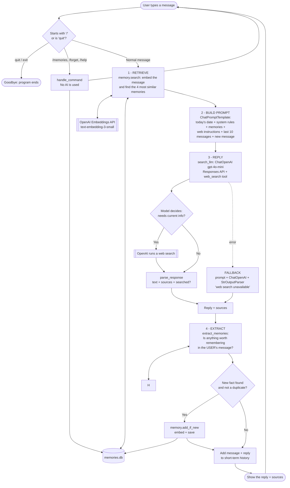

# 🧠 Long-Term Memory Conversational Chat Assistant

A beginner-friendly **Generative AI chatbot** built with **Python**, **LangChain** and the **OpenAI API**.
It chats naturally, remembers the recent conversation, and saves important facts about you in **long-term memory** that stays saved **even after the program is closed and restarted**. For current questions it **searches the web in real time** and shows **clickable sources**.

> **Example:** On Monday you say *"I'm vegetarian and I don't like spicy food."* You close the app.
> On Friday you open it again and ask *"What should I cook tonight?"*. It suggests a **mild vegetarian** dish, because it remembered.

---

## 📑 Table of Contents

1. [Project Overview](#1-project-overview)
2. [Project Features](#2-project-features)
3. [Technologies Used](#3-technologies-used)
4. [Application Architecture](#4-application-architecture)
5. [Project Folder Structure](#5-project-folder-structure)
6. [Installation and Setup](#6-installation-and-setup-windows--vs-code)
7. [API Key Security](#7-api-key-security)
8. [How to Run the Application](#8-how-to-run-the-application)
9. [Code Explanation](#9-code-explanation)
10. [LangChain Components](#10-langchain-components)
11. [Conversation Workflow](#11-conversation-workflow-step-by-step)
12. [Short-Term vs Long-Term Memory](#12-short-term-vs-long-term-memory)
13. [Troubleshooting and Testing](#13-troubleshooting-and-testing)
14. [Limitations and Future Enhancements](#14-limitations-and-future-enhancements)
15. [Learning Outcomes](#15-learning-outcomes)
16. [Interview Preparation](#16-interview-preparation)
17. [GitHub Instructions](#17-github-instructions)
18. [Conclusion](#18-conclusion)

---

## 1. Project Overview

### What does this application do?

It is a **chat assistant that runs in your terminal** (the text window where you type commands). You type a message, and an AI model from OpenAI replies, just like ChatGPT. The difference is that **this assistant builds up a personal memory about you** and uses it in later conversations.

### The problem it solves

AI language models are **stateless**: they do not remember anything between requests. Every time you send a message, the model starts from zero.

| Without memory | With this project |
|---|---|
| "What's my name?" → *"I don't know your name."* | "What's my name?" → *"Your name is Raeesah!"* |
| You must repeat your preferences every time | It remembers your preferences across sessions |
| Closing the app erases everything | Important facts are saved to a file on your computer |

### Purpose

1. **A learning project**: understand, piece by piece, how real GenAI applications (like ChatGPT's "Memory" feature) work inside.
2. **A working demo**: a complete app you can install, run, explain and show in interviews.

---

## 2. Project Features

### ✅ Implemented features (working now)

| Feature | What it means | Where in the code |
|---|---|---|
| 💬 **AI chat** | Talk with OpenAI's `gpt-4o-mini` model | `chatbot.py` |
| 🕐 **Short-term memory** | Remembers the last 10 messages of the current conversation | `chatbot.py` (`history`, `MAX_RECENT_MESSAGES`) |
| 🧠 **Automatic memory extraction** | The AI decides by itself which facts are worth remembering ("I live in Lahore" ✅, "hi there!" ❌) | `memory_extractor.py` |
| 💾 **Persistent long-term memory** | Facts are saved to `memories.db` and survive restarts | `memory_store.py` |
| 🔍 **Semantic memory search** | Finds memories by **meaning**, not exact words ("What should I cook?" finds "The user is vegetarian.") | `memory_store.py` (`search`) |
| 🧩 **Retrieval-Augmented Generation (RAG)** | Relevant memories are added to the AI's instructions before it answers | `chatbot.py` (`chat_turn`) |
| 🚫 **Duplicate prevention** | Avoids saving the same fact twice, even in different words | `memory_extractor.py` + `memory_store.py` (`add_if_new`) |
| 🔄 **Updating changed facts** | "I moved to Karachi" **replaces** "The user lives in Lahore." instead of keeping both | `memory_extractor.py` (`replaces_id`) + `memory_store.py` (`replace`) |
| 🙋 **Honest "I don't know"** | The assistant is told to admit when it doesn't know something instead of inventing it | system prompt in `chatbot.py` |
| 📋 **View memories** | `/memories` command lists everything saved, with IDs and dates | `chatbot.py` (`handle_command`) |
| 🗑️ **Delete memories** | `/forget <id>` deletes one; `/forget all` deletes all (asks for confirmation) | `chatbot.py` + `memory_store.py` |
| 🐞 **Debug view** | Shows which memories were retrieved and saved on every turn | `chatbot.py` (`SHOW_DEBUG`) |
| 🌐 **Web interface** | A chat page in your browser, with a sidebar to view and delete memories | `app.py` (Streamlit) |
| 🔎 **Real-time web search (on/off)** | Answers current questions (news, results, prices, weather, latest versions) by **actually searching the internet**. **Off by default**; turn it on with the **Search the web** toggle (web) or `/web on` (terminal). When on, the model decides when a search is needed | `web_search.py` + `chatbot.py` + `app.py` |
| ⌨️ **Streaming replies** | Answers appear word by word as they're written, instead of all at once | `chatbot.py` (`stream_chat_turn`) + `app.py` (`st.write_stream`) |
| 🔗 **Source citations** | Clickable source titles under each searched answer, taken only from OpenAI's citation data (never invented) | `web_search.py` (`parse_response`) + `app.py` |
| 📅 **Knows today's date** | Today's date is read from your computer's clock and added to every prompt | `chatbot.py` |
| 🛟 **Search failure fallback** | If web search fails, it answers without it, warns you, and says it can't verify current information | `chatbot.py` + `app.py` |

### 🗓️ Planned features (NOT implemented yet)

| Planned feature | Current situation |
|---|---|
| Saving short-term chat history to disk | Chat history is lost when you quit; only extracted *facts* are saved |
| Multiple users with separate memories | One shared `memories.db` for everyone |
| Dedicated vector database (Chroma, PostgreSQL + pgvector, Pinecone) for very large memory collections | SQLite + numpy search, fine for thousands of memories |
| Automated tests (pytest) | Tested manually with the `step6_…` and `step7_…` scripts |
| Deployment to the cloud | Runs only on your own computer |

---

## 3. Technologies Used

| Technology | Version | What it is (simple English) | How this project uses it |
|---|---|---|---|
| **Python** | 3.14 | A popular, beginner-friendly programming language | All the code is written in Python |
| **Streamlit** | 1.66.1 | Turns a Python script into a web page, with no HTML or JavaScript needed | The browser chat interface in `app.py` |
| **OpenAI API** | — | An online service you send text to; OpenAI's AI models send replies back. Paid per use | Generates replies (`gpt-4o-mini`) and creates embeddings (`text-embedding-3-small`) |
| **OpenAI Responses API + `web_search` tool** | — | OpenAI's newer API, which supports **built-in tools**. `web_search` lets the model search the internet and returns citations | Main replies in `chatbot.py` (through `web_search.py`). The older Chat Completions API is still used for the fallback and memory extraction |
| **LangChain** (`langchain`) | 1.4.7 | A toolkit that makes building AI apps easier, with ready-made building blocks | Installed as the main framework package. The code imports its building blocks from the two packages below |
| **LangChain Core** (`langchain-core`) | 1.7.0 | The basic building blocks of LangChain | Messages, prompt templates, the output parser, and the vector store |
| **LangChain OpenAI** (`langchain-openai`) | 1.7.2 | The "adapter" that connects LangChain to OpenAI | `ChatOpenAI` (chat model) and `OpenAIEmbeddings` (embedding model) |
| **python-dotenv** | 1.2.4 | Reads secret settings from a `.env` file | Loads your `OPENAI_API_KEY` without writing it in the code |
| **Pydantic** | 2.14.1 | Describes the exact shape that data must have | Forces the AI to return memories as a clean Python list |
| **NumPy** | 2.5.4 | Fast maths for lists of numbers | Used by the vector store to compare embeddings quickly |
| **SQLite** (`sqlite3`) | built-in | A small database stored in one file, queried with SQL | `memories.db` stores memories (text, date, embedding) |
| **JSON** | built-in | A simple text format for storing data | The old `memories.json` format (read once by the migration script) |
| **uuid / datetime** | built-in | Python's standard tools for random IDs and dates | Gives each memory an ID like `a3f9c2e1` and a timestamp |

### Key terms explained

| Term | Simple meaning | Example |
|---|---|---|
| **LLM** (Large Language Model) | An AI trained on huge amounts of text that can write human-like replies | `gpt-4o-mini` |
| **API** | A way for one program to talk to another over the internet | Our Python code "calls" OpenAI's API |
| **API key** | A secret password that identifies you to OpenAI (and is billed to you) | Starts with `sk-...` |
| **Token** | A small piece of a word; AI usage is measured and paid in tokens | "chatbot" ≈ 2 tokens |
| **Prompt** | The full text/instructions sent to the AI | System instructions + memories + your message |
| **Embedding** | A list of numbers (1,536 here) representing the *meaning* of a text | "I'm vegetarian" → `[-0.014, -0.019, ...]` |
| **Vector store** | A database that stores embeddings and finds the most similar ones | `InMemoryVectorStore` (Step 5); this project's `MemoryStore` (SQLite + numpy) |
| **SQL** | The language for asking a database to store, find or delete rows | `SELECT text FROM memories` |
| **Semantic search** | Searching by meaning instead of exact words | "pets?" finds "cat called Luna" |
| **RAG** | Retrieval-Augmented Generation: *find* relevant info, *add* it to the prompt, then *generate* | How memories reach the AI |
| **Virtual environment** | A private folder of Python packages for one project | The `.venv` folder |

---

## 4. Application Architecture

### The big picture

```
 ┌────────────┐     ┌──────────────────────────────┐     ┌──────────────────┐
 │    You     │ ──► │  Python app (chatbot.py)     │ ──► │   OpenAI API     │
 │ (terminal) │ ◄── │  + LangChain building blocks │ ◄── │ (internet, paid) │
 └────────────┘     └──────────────┬───────────────┘     └──────────────────┘
                                   │ read / write
                                   ▼
                          ┌──────────────────┐
                          │  memories.db     │  ← long-term memory on your disk
                          └──────────────────┘
```

- **Python** runs the program, reads your typing, and prints replies.
- **LangChain** organises the work: builds prompts, talks to OpenAI, and searches memories.
- **The OpenAI API** does the "thinking": writing replies, deciding what to remember, and creating embeddings.
- **`memories.db`** keeps long-term memory on your computer.

### Detailed flowchart



**The four knowledge sources, and what each one answers:**

| Source | Example question | Where it comes from |
|---|---|---|
| LLM training | "What is photosynthesis?" | Built into the model (training data ends in 2023 for `gpt-4o-mini`) |
| Short-term memory | "Who did they beat in the final?" (follow-up) | Last 10 messages |
| Long-term memory | "Where do I live?" | `memories.db` |
| Web search | "Who won the 2026 World Cup?" | The internet, searched live |

They work together. *"What's the weather where I live today?"* uses **long-term memory** (Chennai) **and web search** (today's forecast). Web results are **never saved as memories**, because the extractor only reads the user's own message.

> 💡 **Viewing the diagram:** GitHub shows Mermaid diagrams automatically. In VS Code, install the **"Markdown Preview Mermaid Support"** extension, then open the preview (`Ctrl+Shift+V`).

### API calls per normal message

| # | Call | Model | Purpose |
|---|---|---|---|
| 1 | Embedding | `text-embedding-3-small` | Search memories related to your message |
| 2 | Responses API | `gpt-4o-mini` + `web_search` | Write the reply, searching the web **only if needed** |
| 3 | Chat | `gpt-4o-mini` (temperature 0) | Extract facts worth remembering |
| 4+ | Embedding | `text-embedding-3-small` | Duplicate check + saving, **only if** a new fact was found |

`/memories`, `/forget` and `/help` make **no** API calls; they are free and instant.

### 💰 Costs (from OpenAI's pricing page, October 2026; check the page for current prices)

| Item | Price | Roughly per message |
|---|---|---|
| Web search tool call | $10.00 per 1,000 searches | **~1 cent, only when it searches** |
| Search content read by `gpt-4o-mini` | billed as a fixed 8,000 input tokens per search ($0.15 per 1M) | ~0.12 cents per search |
| `gpt-4o-mini` reply + extraction | $0.15 / 1M input, $0.60 / 1M output tokens | well under 0.1 cent |
| Embeddings (`text-embedding-3-small`) | $0.02 / 1M tokens | negligible |

A reply **with** a search costs about **1.2 cents**; a reply **without** one costs almost nothing. That's why web search is **off by default**, and why, when it's on, the model is told to skip searches for maths, general knowledge and personal questions. Set a monthly spending limit in your OpenAI account to be safe.

---

## 5. Project Folder Structure

```
📁 Long term memory - Conversational chat assistant/
│
├── 🌐 app.py                   ← WEB VERSION: streamlit run app.py (opens in your browser)
├── 🚀 chatbot.py               ← TERMINAL VERSION + the shared chat logic (chat_turn)
├── 💾 memory_store.py          ← Long-term memory engine (save, load, search, delete)
├── 🧠 memory_extractor.py      ← Uses the AI to decide which facts to remember
├── 🔎 web_search.py            ← Search-enabled model (web_search tool) + citation parsing
│
├── 📘 step2_hello.py           ← Learning step 2: first message to OpenAI
├── 📘 step3_chat.py            ← Learning step 3: chat loop + short-term memory
├── 📘 step4_prompt.py          ← Learning step 4: prompt templates and chains
├── 📘 step5_embeddings.py      ← Learning step 5: embeddings and semantic search
├── 🧪 step6_test_store.py      ← Learning step 6: test that memories survive restarts
├── 🧪 step7_test_extractor.py  ← Learning step 7: test memory extraction + duplicates
├── 📘 step13_web_search.py     ← Learning step 13: which questions trigger a web search
├── 🧪 step13_test_fallback.py  ← Learning step 13: test what happens when web search fails
│
├── 📄 requirements.txt         ← List of packages to install
├── 📄 README.md                ← This document
├── 🔒 .gitignore               ← Files Git must never upload (secrets, personal data)
├── 🔑 .env                     ← YOUR SECRET API KEY (never share, never upload)
│
├── 🔁 migrate_json_to_sqlite.py ← One-time copy of old memories.json into memories.db
├── 🔍 view_database.py         ← Prints the database table and its memories (read-only)
│
├── 🗄️ memories.db              ← Created automatically: your saved memories (SQLite)
├── 🗄️ test_memories.db         ← Created by the step6/step7 tests (safe to delete)
├── 🗂️ memories.json            ← OLD storage format, kept as a backup after migration
├── 🗂️ test_memories.json       ← Old test data (safe to delete)
├── 📁 .venv/                   ← Virtual environment with installed packages
└── 📁 __pycache__/             ← Python's automatic cache (safe to ignore)
```

| File | Needed to run the app? | Purpose |
|---|---|---|
| `app.py` | For the web version | The Streamlit web page. It imports `chat_turn` and `memory` from `chatbot.py` |
| `chatbot.py` | ✅ Yes | The prompt and RAG logic (`chat_turn`), plus the terminal chat loop and `/` commands |
| `memory_store.py` | ✅ Yes | Saves, loads, searches, lists and deletes memories |
| `memory_extractor.py` | ✅ Yes | Asks the AI which facts in a message should be remembered |
| `web_search.py` | ✅ Yes | Creates the search-enabled model and reads sources out of its replies |
| `.env` | ✅ Yes | Holds `OPENAI_API_KEY` (you create it yourself) |
| `requirements.txt` | For installing | `pip install -r requirements.txt` installs everything |
| `step2_…` to `step13_…` | ❌ No | Small standalone scripts that teach one concept each. Run them to learn or test |
| `memories.db` | Auto-created | Created on first run. Delete it (with the app stopped) to reset the memory |
| `migrate_json_to_sqlite.py` | Once | Copies memories from the old `memories.json` into `memories.db` |
| `view_database.py` | ❌ No | Shows what's in the database |
| `.gitignore` | For GitHub | Keeps secrets and personal data out of Git |

---

## 6. Installation and Setup (Windows + VS Code)

### Step 1: Install the required software

| Software | Where to get it | Check it's installed |
|---|---|---|
| **Python 3** (built and tested with 3.14) | [python.org/downloads](https://www.python.org/downloads/) | `py --version` |
| **Visual Studio Code** | [code.visualstudio.com](https://code.visualstudio.com/) | Open it from the Start menu |
| **VS Code Python extension** | VS Code → Extensions (`Ctrl+Shift+X`) → search "Python" (by Microsoft) | Installed tab |
| **An OpenAI account with billing** | [platform.openai.com](https://platform.openai.com/) | You can create an API key |

> ⚠️ On Windows, the `python` command may open the Microsoft Store instead of running Python. Use the **`py`** launcher to create the environment. After activation, `python` works inside it.

### Step 2: Open the project in VS Code

1. Open VS Code → **File → Open Folder…** → choose the `Long term memory - Conversational chat assistant` folder.
2. Open a terminal: **Terminal → New Terminal** (or `` Ctrl+` ``). It opens in the project folder.

### Step 3: Create a virtual environment

```powershell
py -m venv .venv
```

This creates a `.venv` folder holding a private copy of Python for this project only.

### Step 4: Activate the virtual environment

```powershell
.\.venv\Scripts\Activate.ps1
```

✅ Success: your terminal prompt now starts with **`(.venv)`**.

❌ If you see *"running scripts is disabled on this system"*, run **one** of these, then activate again:

```powershell
# Allow for your user account (permanent, recommended):
Set-ExecutionPolicy -Scope CurrentUser RemoteSigned

# OR allow only for this terminal window (temporary):
Set-ExecutionPolicy -Scope Process -ExecutionPolicy RemoteSigned
```

**Tell VS Code to use this environment:** press `Ctrl+Shift+P` → **Python: Select Interpreter** → choose the one showing `.venv`.

### Step 5: Install the packages

```powershell
pip install -r requirements.txt
```

This installs every package listed in `requirements.txt`, with the exact versions this project was tested with.

### Step 6: Get an OpenAI API key

1. Go to [platform.openai.com](https://platform.openai.com/) and sign in.
2. Open **API keys** → **Create new secret key**.
3. Copy the key (it starts with `sk-`). You can only see it **once**.
4. Make sure your account has **billing/credits** set up, or requests will fail.

### Step 7: Create the `.env` file

In VS Code: **File → New File** → save it in the project folder as exactly **`.env`** (with the dot, no other extension). Add one line:

```env
OPENAI_API_KEY=sk-your-key-here
```

- No spaces around `=`.
- No quotation marks needed.
- Save the file (`Ctrl+S`).

### Step 8: Verify the setup

```powershell
python -c "import langchain_core, langchain_openai, dotenv, numpy; print('Packages OK')"
python -c "from dotenv import load_dotenv; import os; load_dotenv(); print('API key found:', bool(os.getenv('OPENAI_API_KEY')))"
```

Expected:
```
Packages OK
API key found: True
```

(This only prints `True` or `False`. It never prints the key itself.)

---

## 7. API Key Security

Your API key works like a **credit card number for OpenAI**. Anyone who has it can use the API, and **you pay the bill**.

### How the pieces work together

| Piece | Role |
|---|---|
| **`.env` file** | A plain text file holding `OPENAI_API_KEY=sk-...`. It lives only on your computer |
| **`OPENAI_API_KEY`** | The name of an *environment variable*: a setting your programs can read |
| **`load_dotenv()`** | Called at the top of `chatbot.py`; copies values from `.env` into the environment |
| **`ChatOpenAI` / `OpenAIEmbeddings`** | Automatically read `OPENAI_API_KEY` from the environment, so the key never appears in the code |
| **`.gitignore`** | Tells Git to never upload `.env` (or `memories.db`) to GitHub |

```
.env  ──load_dotenv()──►  environment variable OPENAI_API_KEY  ──►  ChatOpenAI reads it  ──►  OpenAI
```

### Why does `chatbot.py` call `load_dotenv()` before the other imports?

```python
from dotenv import load_dotenv

load_dotenv()  # Must run before importing modules that create OpenAI clients.
```

`memory_extractor.py` creates its OpenAI client **as soon as it is imported**. The key must already be loaded at that moment, otherwise you get a *"Missing credentials"* error.

### Golden rules ✅

- ✅ Keep the key **only** in `.env`.
- ✅ Keep `.env` listed in `.gitignore`.
- ✅ Set a **monthly spending limit** in the OpenAI dashboard (Settings → Limits).
- ✅ If you think your key leaked, **delete it immediately** in the dashboard and create a new one.
- ❌ Never paste the key into Python files, screenshots, chat messages, emails or GitHub.
- ❌ Never share your `.env` file.

### What this project's `.gitignore` protects

```gitignore
.env                 # your secret key
memories.db          # personal facts about you
test_memories.db     # test data
memories.json        # old storage format (backup)
test_memories.json
.venv/               # installed packages (big, and recreatable)
__pycache__/         # Python cache
*.pyc
.vscode/             # editor settings
```

---

## 8. How to Run the Application

There are two versions that share the same memory database (`memories.db`). You can run **both at the same time**: a memory saved or deleted in one is immediately visible to the other, because both read from SQLite on every search. (The web sidebar updates on its next refresh or click.)

### Option A: In your browser (Streamlit)

```powershell
streamlit run app.py
```

Your browser opens at **http://localhost:8501**. ("localhost" means the page runs only on your own computer.) To stop the app, press `Ctrl+C` in the terminal.

| Part of the page | What it does |
|---|---|
| Chat box (bottom) | Type a message and press Enter |
| Under each AI reply | *Remembered: …* and *Updated: …* notes, and a **Memories used** expander (when **Show memory activity** is on) |
| Sidebar list | Every saved memory with its date; the 🗑️ button forgets one |
| **Forget everything** | Opens a confirmation, then deletes all memories |
| **New conversation** | Clears the recent chat (short-term memory). Long-term memories stay |
| **Search the web** toggle | **Off by default.** Turn it on to let the assistant look up current information (about 1 cent per search) |
| *Thinking...* | Shown until the first words of the reply arrive; then the reply appears word by word |
| **Show memory activity** | Turns the memory notes under replies on or off (web sources are always shown) |
| **Searched the web** badge | Appears under a reply when a live web search was used |
| **Sources** list | Numbered, clickable source titles for a searched answer |
| "No source links were returned…" | The model searched but OpenAI returned no citations, so verify the answer yourself |
| **Web search unavailable** warning | Search failed; the answer was given without current information |
| **Saved memories checked (N)** | Expander listing the memories that were given to the AI for this reply |

**Try these questions** (turn on **Search the web** first): *"Who won the 2026 FIFA World Cup?"* (searches), *"What's the weather where I live today?"* (memory + search), *"What is 15% of 200?"* (no search).

**How it works:** Streamlit **reruns `app.py` from top to bottom** on every click or message. The chat history is kept in `st.session_state`, a dictionary that survives reruns in one browser tab. The memory store and AI chain come from `import chatbot`, which Python runs only once, so they aren't recreated on every rerun.

### Option B: In the terminal

Make sure the virtual environment is active (`(.venv)` is shown), then:

```powershell
python chatbot.py
```

### Expected output

```
Chatbot ready! (0 memories loaded). Type /help for commands.

You:
```

The number shows how many memories are saved in `memories.db`.

### Example conversation (first session)

```
You: Hi! I'm Raeesah. I'm a student learning GenAI.
   [retrieved: none]
   [saved: ['The user is named Raeesah.', 'The user is a student learning GenAI.']]
AI: Hi Raeesah! It's great to meet you. How's your learning journey with GenAI going so far?

You: I'm vegetarian, and I really don't like spicy food.
   [retrieved: ['The user is named Raeesah.', 'The user is a student learning GenAI.']]
   [saved: ['The user is vegetarian.', "The user really doesn't like spicy food."]]
AI: Thanks for sharing, Raeesah! If you need any vegetarian recipe ideas or tips that aren't spicy, just let me know!

You: quit
Goodbye!
```

### After restarting (second session)

```
Chatbot ready! (4 memories loaded). Type /help for commands.

You: What should I cook for dinner tonight?
   [retrieved: ['The user is vegetarian.', "The user really doesn't like spicy food.", ...]]
AI: How about a creamy vegetable pasta? ... It's filling and not spicy at all!
```

The lines in `[square brackets]` are **debug output**. They show what the memory system did. To hide them, open `chatbot.py` and set `SHOW_DEBUG = False`.

> AI replies are generated fresh every time, so your exact wording will differ.

### Commands

| Command | What it does | Uses AI? |
|---|---|---|
| `/help` | Shows the list of commands | No |
| `/memories` | Lists every saved memory with its ID and date | No |
| `/forget <id>` | Deletes one memory, e.g. `/forget e910c01e` | No |
| `/forget all` | Deletes **all** memories, after you type `yes` to confirm | No |
| `/web on` / `/web off` | Turns web search on or off for this session (`/web` alone shows the current setting). Off at start-up | No |
| `quit` or `exit` | Closes the program | No |

Example:

```
You: /memories
I remember 2 thing(s):
  [e910c01e] The user lives in Lahore.  (2026-10-23 20:00)
  [e9c0e95b] The user has a cat called Luna.  (2026-10-23 20:00)

You: /forget e910c01e
Forgot memory [e910c01e].
```

### Tips for testing the memory

1. Tell it facts about yourself: name, city, hobbies, food, pets, goals.
2. Type `quit`.
3. Run `python chatbot.py` again.
4. Ask questions that need those facts *without* using the same words (e.g. "Any weekend plan ideas for me?").
5. Ask something you never told it (e.g. "What's my favourite movie?"). It should say it doesn't know.

### Running the learning scripts (optional)

```powershell
python step2_hello.py                 # one message to OpenAI, shows token usage
python step3_chat.py                  # simple chat with short-term memory only
python step4_prompt.py                # shows exactly what a prompt template produces
python step5_embeddings.py            # embedding similarity scores + semantic search
python step6_test_store.py add        # test: save 3 memories, then exit
python step6_test_store.py check      # test: a NEW process reads them back, then deletes one
python step7_test_extractor.py        # test: which messages produce memories, duplicate handling
python step13_web_search.py           # which questions trigger a web search (~2-3 cents per run)
python step13_test_fallback.py        # test: a searched answer, then a simulated search failure
```

The step6 and step7 tests use `test_memories.db`, so they **never touch your real `memories.db`**.

```powershell
python migrate_json_to_sqlite.py      # one-time: copy old memories.json into memories.db
python view_database.py               # show the table structure and all saved memories
```

---

## 9. Code Explanation

### 9.1 `chatbot.py`: the main application

**Imports**

| Import | Why |
|---|---|
| `from dotenv import load_dotenv` | Loads the API key from `.env` (called first, before other imports) |
| `ChatOpenAI` (from `langchain_openai`) | The OpenAI chat model |
| `HumanMessage`, `AIMessage` (from `langchain_core.messages`) | Store the user's and AI's messages in the history |
| `ChatPromptTemplate`, `MessagesPlaceholder` (from `langchain_core.prompts`) | Build the prompt layout |
| `StrOutputParser` (from `langchain_core.output_parsers`) | Turn the AI's reply object into plain text |
| `MemoryStore` (from `memory_store`) | Our long-term memory class |
| `extract_memories` (from `memory_extractor`) | Our fact-extraction function |

**Settings (you can change these)**

```python
MAX_RECENT_MESSAGES = 10  # Short-term memory window (5 user + 5 AI messages).
MEMORIES_TO_RETRIEVE = 4  # How many long-term memories to put in the prompt.
SHOW_DEBUG = True         # Print what was retrieved and saved each turn.
```

**Components created at start-up**

```python
memory = MemoryStore(path="memories.db")             # opens (or creates) the SQLite database
llm = ChatOpenAI(model="gpt-4o-mini", temperature=0.7) # the AI model
chain = prompt | llm | StrOutputParser()               # prompt → AI → plain text
```

- `temperature=0.7` gives slightly varied, natural replies (0 = very predictable, 1 = more creative).
- The **prompt** has three parts: a **system** message containing the `{memories}` blank and behaviour rules; a **`MessagesPlaceholder`** for recent chat history; and a **human** message `{input}` for the new message.

**Functions**

| Function | What it does |
|---|---|
| `format_memories(memories)` | Turns `["A", "B"]` into bullet lines `- A` / `- B` for the prompt, or `(nothing yet)` if empty |
| `chat_turn(user_text, history)` | The heart of the app. Runs one full turn: **retrieve → reply → extract → update history**. Returns the reply |
| `handle_command(command)` | Handles `/memories`, `/forget`, `/help` using plain Python only, with no AI |
| `main()` | Starts the program: creates an empty `history`, then loops: read input → command or chat → print reply |

**Inside `chat_turn`, line by line**

```python
related = memory.search_with_ids(user_text, k=MEMORIES_TO_RETRIEVE)  # 1. retrieve (with IDs)
relevant = [m["text"] for m in related]

reply = chain.invoke({                                     # 2+3. build prompt and get reply
    "memories": format_memories(relevant),
    "chat_history": history[-MAX_RECENT_MESSAGES:],       # only the last 10 messages
    "input": user_text,
})

previous_ai = history[-1].content if history else ""       # the AI's last message, for context
for item in extract_memories(user_text, previous_ai, known_memories=related):  # 4. extract
    if item.replaces_id:
        memory.replace(item.replaces_id, item.text)        # outdated fact -> replace it
    elif memory.add_if_new(item.text): ...                 # new fact -> save unless duplicate

history.append(HumanMessage(content=user_text))           # update short-term memory
history.append(AIMessage(content=reply))
```

- The real function is now the streaming generator `stream_chat_turn` (section 9.5); `chat_turn` wraps it and returns `(reply, activity)`, where `activity` includes `{"retrieved": [...], "saved": [...], "updated": [...]}`. The terminal prints it as debug lines; the web app shows it under each reply.
- `history[-10:]` is Python *slicing*: "the last 10 items of the list".
- The retrieved memories are **reused** for duplicate checking and updates, so one search does three jobs.
- Replacements skip `add_if_new()` on purpose: "lives in Karachi" is very similar to "lives in Lahore", so the duplicate check could wrongly reject it.
- With `SHOW_DEBUG = True`, updates are shown as `[updated: ['old fact -> new fact']]`.

**Inside `main`**

- `input("You: ").strip()` reads what you typed and removes extra spaces. It also strips an invisible "BOM" character that Windows PowerShell can add when text is *piped* into the program.
- Messages starting with `/` go to `handle_command()` and **never reach the AI**.
- `if __name__ == "__main__": main()` means the chat only starts when you run this file directly.

---

### 9.2 `memory_store.py`: the long-term memory engine

Memories are stored in **SQLite**, a database kept in a single file (`memories.db`). It's built into Python (`import sqlite3`), so nothing extra needs installing.

**Imports:** `sqlite3` (database), `uuid` (random IDs), `datetime` (timestamps), `numpy` (vector maths), `OpenAIEmbeddings`.

**The table** (created automatically on first run):

```sql
CREATE TABLE IF NOT EXISTS memories (
  id TEXT PRIMARY KEY,          -- e.g. 'c1ae3721'
  text TEXT NOT NULL,           -- e.g. 'The user lives in Chennai.'
  created_at TEXT NOT NULL,     -- e.g. '2026-10-23 21:10'
  embedding BLOB NOT NULL       -- 1,536 float32 numbers = 6,144 bytes
)
```

**Helpers:** `_to_blob(vector)` packs the 1,536 numbers into bytes for the `embedding` column; `_from_blob(blob)` unpacks them into a numpy array.

**Class `MemoryStore`**: same methods as before, so `chatbot.py` and `app.py` didn't need to change. Hiding *how* data is stored behind fixed methods is called **encapsulation**.

| Method | What it does | Key SQL / code |
|---|---|---|
| `__init__(path)` | Creates the embedding model and the table (if missing) | `CREATE TABLE IF NOT EXISTS ...` |
| `_run(sql, params)` | Opens a connection, runs one statement, **commits** (saves), closes, and returns the rows. A fresh connection each time lets the web app, the terminal and Streamlit's threads all share the database safely | `sqlite3.connect(...)`, `execute`, `commit` |
| `add(text)` | Creates an ID and timestamp, embeds the text (1 API call), stores the row | calls `add_existing(...)` |
| `add_existing(id, text, created_at, vector)` | Stores a memory that already has an ID, date and vector (used by the migration script) | `INSERT OR REPLACE INTO memories ... VALUES (?, ?, ?, ?)` |
| `add_if_new(text, duplicate_threshold=0.85)` | Adds only if the closest existing memory scores below 0.85. Returns the ID, or `None` for duplicates | `self.search(text, k=1)` |
| `replace(old_id, new_text)` | Deletes the outdated memory and adds the updated one (no duplicate check) | `self.delete` + `self.add` |
| `search_with_ids(query, k=4)` | Loads all embeddings, embeds the query, computes **cosine similarity with numpy** for every memory at once, and returns the top `k` as `{id, text, score}`. Returns `[]` if empty (no wasted API call) | `vectors @ query_vector / (norms...)`, `np.argsort` |
| `search(query, k=4)` | Same search, returning `(text, score)` pairs | `self.search_with_ids(...)` |
| `list_all()` | All memories, oldest first | `SELECT id, text, created_at FROM memories ORDER BY created_at, rowid` |
| `delete(memory_id)` | Deletes one memory. Returns `False` if the ID doesn't exist | `SELECT 1 ... WHERE id = ?` then `DELETE ... WHERE id = ?` |
| `clear()` | Deletes every memory | `DELETE FROM memories` |

**Safe SQL with `?` placeholders.** Values are passed separately from the SQL text: `execute("DELETE FROM memories WHERE id = ?", (memory_id,))`. Never build SQL with f-strings. A malicious value like `x' OR '1'='1` could otherwise change the query's meaning (this attack is called **SQL injection**).

**Why numpy instead of a LangChain vector store?** SQLite can store vectors but can't compare them by itself. LangChain's SQLite vector store (in `langchain-community`) needs an extra package and the `sqlite-vec` extension, which some Windows Python builds block. Plain `sqlite3` + numpy needs nothing new and is fast enough for thousands of memories. Testing showed the same similarity scores as the earlier `InMemoryVectorStore` version (e.g. 0.3818 for "any pets?").

**Moving old memories from `memories.json`:** `python migrate_json_to_sqlite.py` copies every memory, reusing the saved vectors (no API calls). It's safe to run more than once, and it leaves `memories.json` untouched as a backup.

**Looking inside the database:** `python view_database.py` prints the table structure and every memory (read-only, no API calls):

```
Table structure in memories.db:
CREATE TABLE memories (  id TEXT PRIMARY KEY,  text TEXT NOT NULL,  created_at TEXT NOT NULL,  embedding BLOB NOT NULL)

2 memories:
  [c1ae3721] The user is Fouzia.  (2026-10-23 21:10, embedding: 6144 bytes)
  [9143c317] The user lives in Chennai.  (2026-10-23 21:10, embedding: 6144 bytes)
```

You can also open `memories.db` in the free **DB Browser for SQLite** app.

---

### 9.3 `memory_extractor.py`: deciding what to remember

**Imports:** `BaseModel`, `Field` (from `pydantic`), `ChatOpenAI`, `ChatPromptTemplate`.

**Classes `MemoryItem` and `ExtractedMemories`**: the *shape* the AI must return:

```python
class MemoryItem(BaseModel):
    text: str = Field(description="The fact, as one short sentence starting with 'The user'.")
    replaces_id: str | None = Field(
        description="ID of a known memory this fact updates or contradicts, otherwise null."
    )


class ExtractedMemories(BaseModel):
    memories: list[MemoryItem] = Field(
        description="Facts worth remembering about the user. Empty list if there are none."
    )
```

Each extracted fact has its `text`, plus an optional `replaces_id` pointing at an outdated memory.

**`EXTRACTION_PROMPT`**: instructions telling the AI:
- **SAVE:** name, location, job, studies, family, pets, preferences, dislikes, allergies, diet, goals, important dates and plans.
- **DON'T SAVE:** greetings, small talk, temporary feelings ("I'm tired"), questions, general world facts.
- **Rules:** one short sentence per fact, starting with "The user"; don't repeat already-known facts; if a fact updates or contradicts a known memory (moved, changed jobs, no longer has something), set `replaces_id` to that memory's ID; return an empty list if there's nothing to save.

**Module-level objects**

```python
_llm = ChatOpenAI(model="gpt-4o-mini", temperature=0)          # 0 = consistent decisions
_extraction_chain = EXTRACTION_PROMPT | _llm.with_structured_output(ExtractedMemories)
```

`with_structured_output()` forces the AI to return an `ExtractedMemories` object, so the code receives a real Python list, not free text that would need fragile parsing.

**Function `extract_memories(user_message, previous_ai_message="", known_memories=None)`**: returns a list of `MemoryItem` objects, e.g. `[MemoryItem(text="The user lives in Karachi.", replaces_id="9f9a1923")]`, or `[]`.

- `previous_ai_message` gives context. If the AI asked *"What's your cat called?"* and you reply *"Luna"*, the extractor understands → *"The user has a cat named Luna."*
- `known_memories` is a list of `{"id", "text"}` dictionaries, shown to the AI as `- [9f9a1923] The user lives in Lahore.` It lets the AI skip facts already saved in different words ("I don't eat meat" when "The user is vegetarian" is already known), and point at outdated memories by ID.
- **Safety check:** an LLM can invent an ID that doesn't exist. Any `replaces_id` that wasn't in `known_memories` is reset to `None`, so the fact is treated as new instead of deleting the wrong memory.

**Tested updates** (from running `chatbot.py`):

| User message | Result |
|---|---|
| "I live in Lahore, I have a cat called Luna, and I work as a teacher." | 3 new memories saved |
| "Guess what, I just moved to Karachi!" | *lives in Lahore* → **replaced** by *lives in Karachi* |
| "Sadly I had to give Luna away to my aunt." | *has a cat called Luna* → **replaced** by *had to give Luna away to their aunt* |
| "I also have a sister called Sara." | **new** memory (nothing replaced) |
| "I quit teaching, I'm a data analyst now." | *works as a teacher* → **replaced** by *is now a data analyst* |
| "Yep, Karachi is home now." | nothing saved (already known) |

**Tested results** (from `step7_test_extractor.py`):

| User message | Result |
|---|---|
| "hi there!" | nothing saved |
| "btw I just moved to Lahore, so tired lol" | "The user just moved to Lahore." (tiredness ignored) |
| "What's the capital of France?" | nothing saved |
| "Luna" (after *"What's your cat called?"*) | "The user has a cat named Luna." |
| "I'm a vegetarian and I'm allergic to peanuts" | two separate memories |
| "Like I said, I don't eat meat." | nothing saved (already known) |

---

### 9.4 `web_search.py`: real-time web search

**Why a separate file?** Web search is a **built-in tool of OpenAI's Responses API**. The older Chat Completions API (used by the rest of the project) doesn't support it. Keeping the Responses-specific code in one small module keeps `chatbot.py` clean, and makes the search model easy to change.

```python
SEARCH_MODEL = "gpt-4o-mini"   # change to "gpt-4.1-mini" if OpenAI drops web search support for this model

_llm = ChatOpenAI(
    model=SEARCH_MODEL,
    temperature=0.7,
    use_responses_api=True,          # web_search is a Responses API tool
    output_version="responses/v1",   # put search calls and citations into message.content
)
search_llm = _llm.bind_tools([{"type": "web_search"}])   # tool_choice "auto": model decides
```

With web search, a reply's `content` is a **list of blocks** instead of a plain string:

```python
[
  {"type": "web_search_call", "status": "completed", "action": {"query": "Chennai weather today", ...}},
  {"type": "text", "text": "Spain won ... ([fifa.com](https://...))",
   "annotations": [{"type": "url_citation", "title": "...", "url": "https://...", "start_index": 0, "end_index": 120}]}
]
```

**Function `parse_response(message)`** returns `{"text": ..., "searched": True/False, "sources": [{"title", "url"}, ...]}`:
- `searched` is `True` only if a `web_search_call` block exists, which is proof a search actually ran.
- `sources` come **only** from `url_citation` annotations (OpenAI's record of what was retrieved), never from the answer text, and duplicates are removed. That's how the app avoids showing invented links.
- `text` is `message.text`, all the text blocks joined. It includes the model's inline citations like `([fifa.com](https://...))`, placed next to the claims they support.

### 9.5 How `chatbot.py` uses web search and streaming

```python
WEB_SEARCH_DEFAULT = False                    # web search starts OFF (each search ~1 cent)
search_chain = prompt | search_llm            # can search; streams AIMessageChunks
chain        = prompt | llm | StrOutputParser()   # original chain: no internet; streams plain text
```

- **`{today}`**: `date.today()` is formatted as e.g. `Friday, 23 October 2026` on every message. It's never hard-coded, so "latest" and "today" always mean the real today.
- **`{web_instructions}`** is one of three texts:
  - `SEARCH_INSTRUCTIONS`: when to search; trust search results over training and over memories for world facts; cite sources; say clearly when something can't be verified; never invent links; summarise.
  - `WEB_OFF_INSTRUCTIONS`: search is switched off, so say knowledge may be out of date and suggest turning it on.
  - `NO_SEARCH_INSTRUCTIONS`: search failed, so say current info can't be verified.
- **The prompt keeps memories and web results separate:** *"Memories are facts about the user only; never search the web for facts about the user."*

**`stream_chat_turn(user_text, history, activity, use_web_search)`** is a **generator**: it uses `yield` to hand out the reply piece by piece while the model is still writing it.

```python
if use_web_search:
    try:
        for chunk in search_chain.stream({**inputs, "web_instructions": SEARCH_INSTRUCTIONS}):
            full_message = chunk if full_message is None else full_message + chunk   # rebuild the whole message
            if chunk.text:
                pieces.append(chunk.text)
                yield chunk.text                                                     # show this piece now
    except Exception as error:
        search_error = f"{type(error).__name__}: {str(error)[:200]}"
else:
    for piece in chain.stream({**inputs, "web_instructions": WEB_OFF_INSTRUCTIONS}):
        pieces.append(piece)
        yield piece
```

- **Adding chunks together** (`full_message + chunk`) rebuilds the complete message, so `parse_response(full_message)` can read the sources and "searched?" flag at the end. (That's why the chain no longer ends with `RunnableLambda(parse_response)`: a plain function would wait for the whole message and stop the streaming.)
- **If search fails before any text was shown**, the original chain streams an answer instead (with `NO_SEARCH_INSTRUCTIONS`). **If it fails part-way**, the text already shown is kept and `*(This answer was cut off by an error.)*` is added.
- When the generator finishes, it fills the caller's `activity` dict: `retrieved`, `saved`, `updated`, `searched`, `sources`, `search_error`.
- **`chat_turn(user_text, history, use_web_search)`** is a small non-streaming wrapper (`"".join(stream_chat_turn(...))`) used by the test scripts.
- **Terminal:** prints each piece with `print(piece, end="", flush=True)`, then the debug lines and sources. `/web on` / `/web off` change `settings["web_search"]`.
- **Web app:** `st.write_stream(reply_pieces())` shows the pieces with a typing effect; a *Thinking...* note is shown until the first piece arrives. The **Search the web** toggle is stored in `st.session_state.web_search`.
- History stores only the reply **text**, as an `AIMessage`, so follow-up questions ("Who did they beat?") can use the earlier answer without searching again.

### 9.6 The learning scripts (`step2_…` to `step13_…`)

| File | Concept it teaches |
|---|---|
| `step2_hello.py` | `ChatOpenAI`, `SystemMessage`, `HumanMessage`, `llm.invoke()`, token usage |
| `step3_chat.py` | Chat loop; `USE_MEMORY` switch shows the model is **stateless** without history |
| `step4_prompt.py` | `ChatPromptTemplate`, `MessagesPlaceholder`, chains with `\|`, `StrOutputParser`; prints the filled prompt |
| `step5_embeddings.py` | `OpenAIEmbeddings`, hand-written cosine similarity, `InMemoryVectorStore` search |
| `step6_test_store.py` | Proves memories survive a restart (two separate processes: `add`, then `check`) |
| `step7_test_extractor.py` | Tests extraction rules and duplicate handling |
| `step13_web_search.py` | `SystemMessage` with today's date + `HumanMessage` sent to `search_llm`; shows which questions trigger a search and their sources |
| `step13_test_fallback.py` | Replaces the search chain with one that always fails (**mocking**) to test the fallback |

---

## 10. LangChain Components

| Component | Package | Used in | What it does | Simple analogy |
|---|---|---|---|---|
| `ChatOpenAI` | `langchain_openai` | `chatbot.py`, `memory_extractor.py`, steps 2–4 | Connects to OpenAI chat models like `gpt-4o-mini` | The phone line to the AI |
| `OpenAIEmbeddings` | `langchain_openai` | `memory_store.py`, step 5 | Turns text into 1,536 numbers representing meaning | A translator from words to coordinates |
| `SystemMessage` | `langchain_core.messages` | steps 2–3 | Instructions on *how* the AI should behave | A job description |
| `HumanMessage` | `langchain_core.messages` | `chatbot.py`, steps 2–4 | A message from the user | Your side of the chat |
| `AIMessage` | `langchain_core.messages` | `chatbot.py`, steps 3–4 | A message from the AI (also what `llm.invoke()` returns) | The AI's side of the chat |
| `llm.invoke(messages)` | — | steps 2–3 | Sends messages to the model and returns an `AIMessage` with `.content` and `.usage_metadata` | Pressing "send" |
| `ChatPromptTemplate` | `langchain_core.prompts` | `chatbot.py`, `memory_extractor.py`, step 4 | A reusable prompt layout with blanks like `{memories}` and `{input}` | A form letter with blanks |
| `MessagesPlaceholder` | `langchain_core.prompts` | `chatbot.py`, step 4 | A slot in the template for a **list** of messages (chat history) | A "paste conversation here" box |
| `StrOutputParser` | `langchain_core.output_parsers` | `chatbot.py`, step 4 | Extracts the plain text from an `AIMessage` | Taking the letter out of the envelope |
| `\|` (pipe / chain) | `langchain_core` | `chatbot.py`, `memory_extractor.py`, step 4 | Connects components: each output feeds the next | An assembly line |
| `chain.invoke({...})` | — | `chatbot.py`, `memory_extractor.py` | Runs the whole chain with values for the blanks | Starting the assembly line |
| `.with_structured_output(Model)` | `langchain_openai` | `memory_extractor.py` | Forces the AI to return data in a Pydantic shape | A form with fixed boxes to fill |
| `ChatOpenAI(use_responses_api=True)` | `langchain_openai` | `web_search.py` | Uses OpenAI's Responses API, which supports built-in tools like web search | A newer phone line with extra features |
| `.bind_tools([{"type": "web_search"}])` | `langchain_openai` | `web_search.py` | Gives the model a tool it **may** use; returns a new Runnable, so it still works with `\|` | Handing the assistant a search engine |
| `RunnableLambda(func)` | `langchain_core.runnables` | `chatbot.py` | Turns an ordinary Python function (`parse_response`) into a chain step | A custom station on the assembly line |
| `message.text` | `langchain_core.messages` | `web_search.py` | Joins the text blocks of a multi-block reply into one string | Reading just the letter, skipping the attachments |
| `InMemoryVectorStore` | `langchain_core.vectorstores` | step 5 (earlier versions of `memory_store.py`) | Stores texts + embeddings, finds the most similar; `.dump()`/`.load()` save to and read from a file. Replaced by SQLite + numpy in `memory_store.py` | A library sorted by meaning |
| `Document` | `langchain_core` | returned by vector store searches | A text (`page_content`) plus `metadata` | An index card |

### `llm.invoke()` vs `chain.invoke()`

```python
# step2_hello.py: call the model directly with a list of messages
response = llm.invoke([SystemMessage(content="..."), HumanMessage(content="...")])
print(response.content)          # response is an AIMessage

# chatbot.py: call a chain with a dictionary of values for the template blanks
reply = chain.invoke({"memories": "...", "chat_history": [...], "input": "..."})
print(reply)                     # reply is already a plain string (thanks to StrOutputParser)
```

Every LangChain component shares the same `.invoke()` method. This common interface is called a **Runnable**, and it's what makes `|` chaining possible.

---

## 11. Conversation Workflow (Step by Step)

**Situation:** saved memories are *"The user is vegetarian."*, *"The user really doesn't like spicy food."* and *"The user has an exam on 15 November."* The app was just restarted, so short-term history is empty.

**You type:** `What should I cook for dinner tonight?`

| Step | What happens | Component |
|---|---|---|
| 1 | `main()` reads the text and strips spaces. It doesn't start with `/` and isn't `quit` | `input()` |
| 2 | `chat_turn()` starts | `chatbot.py` |
| 3 | **Retrieve:** the message is converted into an embedding (1 API call) | `OpenAIEmbeddings` |
| 4 | It is compared with every saved memory's embedding; the 4 closest are returned. *"vegetarian"* ranks first, even though "cook" ≠ "vegetarian" | `MemoryStore` (SQLite + numpy) |
| 5 | **Build prompt:** the template is filled in: | `ChatPromptTemplate` |
| | • system: rules + `- The user is vegetarian.` / `- …spicy food.` / … | |
| | • history: (empty, just restarted) | `MessagesPlaceholder` |
| | • human: "What should I cook for dinner tonight?" | |
| 6 | **Reply:** the prompt is sent to `gpt-4o-mini` (1 API call) | `ChatOpenAI` |
| 7 | The `AIMessage` is turned into a string | `StrOutputParser` |
| 8 | **Extract:** the message is checked for new facts (1 API call). It's a question, so the result is `[]` and nothing is saved | `extract_memories` |
| 9 | Debug line printed: `[retrieved: [...]]` | `SHOW_DEBUG` |
| 10 | Your message and the reply are added to `history` | `HumanMessage`, `AIMessage` |
| 11 | Reply printed: *"How about a creamy vegetable pasta? … not spicy at all!"* | `print()` |

**If instead you type a fact**, e.g. `I just adopted a dog called Max`, step 8 returns `["The user has a dog named Max."]`. `add_if_new()` checks it's not a duplicate, creates an embedding, saves it to `memories.db`, and the debug output shows `[saved: [...]]`.

**If you type a changed fact**, e.g. `I moved to Karachi` when *"The user lives in Lahore."* was retrieved in step 4, step 8 returns `text="The user lives in Karachi."` with `replaces_id` set to the Lahore memory's ID. `memory.replace()` deletes the old memory and saves the new one, and the debug output shows `[updated: ['The user lives in Lahore. -> The user lives in Karachi.']]`.

**If you type a command**, e.g. `/memories`, steps 2–11 are skipped. `handle_command()` reads the memories from `memories.db` with a SQL `SELECT` and prints them. No AI is used.

---

## 12. Short-Term vs Long-Term Memory

> **Memory is not world knowledge.** Neither kind of memory knows about current events; that's what **web search** is for (section 4). Long-term memory holds facts about *you*; web results are shown with their sources but are **never** saved as memories.

| | 🕐 Short-term memory | 🧠 Long-term memory |
|---|---|---|
| **What it stores** | The exact recent messages (both yours and the AI's) | Short facts *about you*, extracted by the AI |
| **Where** | `history` list in RAM (computer memory) | `memories.db` file on disk |
| **How much** | Only the last **10** messages are sent to the AI | Unlimited; the **4** most relevant are sent each turn |
| **How it's chosen** | Most **recent** | Most **relevant** (semantic search) |
| **Survives restart?** | ❌ **No**, lost when you type `quit` | ✅ **Yes**, stored in the SQLite database and read whenever needed |
| **Implemented?** | ✅ Yes (`chatbot.py`) | ✅ Yes (`memory_store.py` + `memory_extractor.py`) |
| **Human analogy** | Remembering what someone said a minute ago | Remembering a friend's birthday years later |

### What survives a restart, exactly?

| Information | After restart |
|---|---|
| Facts extracted into memories (e.g. "The user is vegetarian.") | ✅ Kept |
| The word-for-word conversation (what you and the AI said) | ❌ Lost |
| Things mentioned in conversation that the extractor did not consider important | ❌ Lost |

### Why use both?

- **Short-term** handles follow-up questions in the same chat: *"Tell me more about the second one."*
- **Long-term** handles personal knowledge across days or weeks: *"Remember I'm vegetarian?"*
- Sending the *entire* history every time would cost more tokens per message and eventually exceed the model's limit, so short-term memory is a **sliding window** of the last 10 messages.

### What would be needed to also keep the full conversation history?

This is **not implemented**. It would need:
1. Saving `history` to a file (e.g. `chat_history.json`) or a database after each turn.
2. Loading it back in `main()` at start-up.
3. Possibly *summarising* old conversations to keep prompts small.

LangChain provides helpers for this (chat message history classes and `trim_messages()`).

---

## 13. Troubleshooting and Testing

### Common errors and fixes

| Error message (or symptom) | Likely cause | Fix |
|---|---|---|
| `Python was not found; run without arguments to install from the Microsoft Store` | Windows "App execution alias" for `python` | Use `py` to create the venv; inside the active venv, `python` works |
| `running scripts is disabled on this system` | PowerShell security policy | `Set-ExecutionPolicy -Scope CurrentUser RemoteSigned` |
| `ModuleNotFoundError: No module named 'langchain_openai'` (or `dotenv`) | venv not activated, or VS Code using a different Python | Activate `.venv`; `Ctrl+Shift+P` → *Python: Select Interpreter* → `.venv`; then `pip install -r requirements.txt` |
| `ImportError: cosine_similarity requires numpy to be installed` | NumPy missing | `pip install numpy` (it's in `requirements.txt`) |
| Memories "disappear", or a second `memories.db` appears somewhere else | `chatbot.py` was started from a different folder; `memories.db` is created in the **current terminal folder** | `cd` into the project folder before running `python chatbot.py` |
| `OpenAIError: Missing credentials ... set the OPENAI_API_KEY` | `.env` missing, misnamed (e.g. `.env.txt`), or the script is outside the project folder | Check the `.env` name and location; the line must be `OPENAI_API_KEY=sk-...` |
| `AuthenticationError: Error code: 401 ... Incorrect API key` | Wrong, expired or deleted key | Create a new key and update `.env` |
| `RateLimitError: Error code: 429 ... insufficient_quota` | No credits or billing on your OpenAI account | Add billing/credits at platform.openai.com |
| `RateLimitError: Error code: 429 ... Rate limit reached` | Too many requests too quickly | Wait a minute and try again |
| `NotFoundError: Error code: 404 ... model ... does not exist` | Your account can't access the model, or the model was retired | Change `model="gpt-4o-mini"` in `chatbot.py`, `memory_extractor.py` and `SEARCH_MODEL` in `web_search.py` to a model your account lists |
| **"Web search unavailable"** warning on every message | The search call fails (network, quota, or model doesn't support `web_search`) | Run `python step13_web_search.py` to see the actual error. If it says the model or tool isn't supported, set `SEARCH_MODEL = "gpt-4.1-mini"` in `web_search.py` |
| `BadRequestError ... web_search ... not supported` | The search model doesn't support the web search tool | Set `SEARCH_MODEL = "gpt-4.1-mini"` in `web_search.py` |
| Bot says "my knowledge ends in October 2023" for a current question | Web search is **off** (the default), it decided not to search, or the search failed | Turn on **Search the web** (web app) or type `/web on` (terminal); ask more explicitly ("search the web for…"); check for the **Web search unavailable** warning |
| Searched, but "No source links were returned" | OpenAI returned no citations (happened in testing with weather questions) | Treat the answer as unverified |
| A weather answer is very long | The search tool hands the model a full forecast, which it reproduces | Known limitation (see section 14) |
| `APIConnectionError: Connection error` | No internet, firewall, VPN or proxy | Check your connection; try another network |
| `/memories` sent to the AI instead of running the command | An invisible BOM character at the start of piped input | Already handled in `chatbot.py`; when typing interactively this doesn't occur |
| `sqlite3.OperationalError: database is locked` | Another program (e.g. DB Browser for SQLite) has the database open with unsaved changes | Close or "Write Changes" in the other program, then try again |
| `sqlite3.OperationalError: no such column: ...` in your own SQL | Text values were written in "double quotes" (SQL treats those as column names). PowerShell can also turn `'` into `"` in one-line commands | Use 'single quotes' for text in SQL, and put SQL in a `.py` file (like `view_database.py`) instead of a one-liner |
| Memories missing after switching to SQLite | Old memories are still only in `memories.json` | Run `python migrate_json_to_sqlite.py` once |
| The bot "forgot" something from earlier in the chat | It slid out of the 10-message window and wasn't saved as a fact | Increase `MAX_RECENT_MESSAGES`, or state the fact clearly so it's extracted |

### Verification commands

```powershell
# 1. Which Python is running? (should point inside .venv)
python -c "import sys; print(sys.executable)"

# 2. Are the packages installed?
pip list | Select-String "langchain|openai|dotenv|numpy|pydantic"

# 3. Is the API key being loaded? (prints True/False only, never the key)
python -c "from dotenv import load_dotenv; import os; load_dotenv(); print('API key found:', bool(os.getenv('OPENAI_API_KEY')))"

# 4. Can we reach OpenAI? (one small, cheap request)
python step2_hello.py
```

### Manual test plan

| # | Test | How | Expected result |
|---|---|---|---|
| 1 | Basic chat | `python step2_hello.py` | A short reply about LangChain + token usage |
| 2 | Short-term memory | In `chatbot.py`: "My name is X" → "What's my name?" | Correct name |
| 3 | Persistence | `python step6_test_store.py add` then `python step6_test_store.py check` | 3 memories listed by the second process |
| 4 | Extraction rules | `python step7_test_extractor.py` | Results match the table in section 9.3 |
| 5 | Restart recall | Tell facts → `quit` → restart → ask about them | Facts recalled |
| 6 | Semantic retrieval | Say "I'm vegetarian" → restart → "What should I cook?" | Vegetarian suggestion |
| 7 | No hallucination | Ask "What's my favourite movie?" (never told) | "I don't know" style answer |
| 8 | View memories | `/memories` | List with IDs and dates |
| 9 | Delete one | `/forget <id>` → restart → `/memories` | That memory is gone |
| 10 | Delete all (cancel) | `/forget all` → `no` | "Cancelled.", memories kept |
| 11 | Bad input | `/forget nosuchid`, `/banana` | Friendly error messages |
| 12 | Updating facts | "I live in Lahore" → "I moved to Karachi" → `/memories` | Only *lives in Karachi* remains; debug shows `[updated: ...]` |
| 13 | Web search decisions | `python step13_web_search.py` | Maths and general knowledge: `Searched the web: no`; current questions: `YES` with `Source:` lines |
| 14 | Current information | Web app: "Who won the 2026 FIFA World Cup?" | **Searched the web** badge + clickable sources |
| 15 | Memory + search together | "What's the weather where I live today?" | Uses your saved city in the search |
| 16 | Follow-up without re-searching | Then ask "Who did they beat in the final?" | Answered from short-term history; no badge |
| 17 | Search failure | `python step13_test_fallback.py` | `search_error=ConnectionError...`, an honest "can't verify" answer, no sources, memory still works |
| 18 | Migration | `python migrate_json_to_sqlite.py`, then `python view_database.py` | Every memory from `memories.json` listed, each with a 6144-byte embedding |
| 19 | Both versions at once | Start `streamlit run app.py`; in a second terminal run `python chatbot.py` and tell it a fact; refresh the web page | The new fact appears in the web sidebar |
| 20 | Web search off (default) | Web app with the toggle off: "Who won the 2026 FIFA World Cup?" | Says its knowledge may be out of date; no badge, no sources |
| 21 | Web search on | Turn on **Search the web**, ask again | Badge + clickable sources |
| 22 | Terminal switch | `python chatbot.py`, then `/web`, `/web on` | "Web search is OFF", then "Web search is ON" |
| 23 | Streaming | Ask any question | *Thinking...*, then the answer appears word by word |

---

## 14. Limitations and Future Enhancements

### Current limitations

| Limitation | Explanation |
|---|---|
| **Updates depend on retrieval** | A changed fact can only replace an old memory if that memory is among the 4 retrieved for the message. With many memories, an old one may be missed and both kept; use `/forget` to remove it |
| **One fact replaces one memory** | If one old memory held two facts, or one change affects several memories, only one is replaced |
| **Conversation text isn't saved** | Only extracted facts survive a restart; the actual chat is lost |
| **Single user** | Everyone using this computer shares one `memories.db` |
| **Search reads every memory** | Each search loads all embeddings from SQLite and compares them with numpy. Fast for thousands of memories; for millions, a dedicated vector database would be needed |
| **Web page is local only** | `app.py` runs on your computer (`localhost`); it is not deployed online |
| **Always retrieves 4 memories** | Even unrelated ones are included (the AI is told to ignore them), which uses a few extra tokens |
| **Extraction isn't perfect** | The AI may occasionally miss a fact or save something unimportant |
| **Needs internet and paid credits** | Every normal message calls the OpenAI API; each web search costs about 1 cent extra |
| **Citations aren't proof** | Sources show *where* information came from, not that it's correct. In testing, one answer cited `test.python.org` (a test copy of the site) and a weather link had a mismatched date in its URL. Click and judge sources yourself |
| **Sometimes no citations** | A search can return no `url_citation` annotations; the app then says "please verify" |
| **Long weather answers** | Weather searches return full forecasts that the model copies, despite the "summarise" instruction |
| **The model decides when to search** | It may occasionally skip a search it should do, or search when it didn't need to |
| **Web search setting isn't saved** | The toggle and `/web` setting reset to **off** each time the app starts (change `WEB_SEARCH_DEFAULT` in `chatbot.py` to start with it on) |
| **Sources appear after the answer finishes** | Citations are only complete once the whole message has arrived, so the source list shows up after streaming ends |
| **`gpt-4o-mini` web search support is not in OpenAI's guide** | It worked in testing (October 2026), but the guide lists `gpt-4.1-mini`, `gpt-4.1` and newer models. Change `SEARCH_MODEL` if it stops working |
| **Memories are stored unencrypted** | Anyone with access to your computer can open `memories.db` and read the memories |
| **No automated tests** | Testing is done by running scripts and checking the output by eye |
| **Model name is hard-coded** | `gpt-4o-mini` is written in two files; changing it requires editing both |

### Suggested future enhancements

| Area | Enhancement | Tools |
|---|---|---|
| 🧠 Memory quality | Keep a history of replaced facts ("lived in Lahore until Oct 2026"); search more widely for outdated memories | Extra metadata (`replaced_at`), a separate search on the new fact |
| 💾 Persistent chat history | Save and reload full conversations; summarise old ones | LangChain chat message history, `trim_messages()` |
| 🗄️ Database | For very large collections, move from SQLite + numpy to a dedicated vector database | **Chroma**, **PostgreSQL + pgvector**, **sqlite-vec** |
| 👥 Multiple users | Separate memories per user (a `user_id` in metadata, or one file per user) | Metadata filtering |
| 🖥️ User interface | Memory search box, user login | `st.text_input`, `st.login` |
| ⚙️ Configuration | Move model names and settings into `.env` or a config file | `python-dotenv`, `pydantic-settings` |
| 🧪 Testing | Automated tests for `MemoryStore` and the commands | **pytest**, with fake embeddings to avoid API costs |
| 📊 Monitoring | Track prompts, costs and errors | **LangSmith** |
| 🔐 Privacy | Encrypt `memories.db`; add memory export | `cryptography` package |
| ☁️ Deployment | Put the app online | Streamlit Community Cloud, Docker, Render, Azure |
| ⚡ Speed | Run extraction in the background so replies appear faster | `async` / threads |

---

## 15. Learning Outcomes

By building and studying this project, a beginner learns:

| Skill | Where you practised it |
|---|---|
| Setting up Python projects with virtual environments and `requirements.txt` | Setup |
| Keeping API keys safe with `.env` and `.gitignore` | Setup, section 7 |
| Calling an LLM through LangChain and reading token usage | `step2_hello.py` |
| Why LLMs are **stateless** and how chat memory is really built | `step3_chat.py` |
| Designing prompts with templates, placeholders and system instructions | `step4_prompt.py`, `chatbot.py` |
| Building **chains** with `\|` and understanding Runnables | `step4_prompt.py` |
| What **embeddings** are and how **semantic search** works | `step5_embeddings.py` |
| Using a **vector store** and saving it to disk (persistence) | `step5_embeddings.py`, `memory_store.py` |
| Storing data in **SQLite** with safe, parameterised SQL; migrating data between formats | `memory_store.py`, `migrate_json_to_sqlite.py` |
| Calling a **built-in tool** (web search) and showing **citations** | `web_search.py`, `app.py` |
| Getting reliable, machine-readable output with **structured output** and Pydantic | `memory_extractor.py` |
| Combining embeddings (fast, topic-level) with LLM reasoning (slow, meaning-level) | Duplicate handling in Step 7 |
| The **RAG** pattern: retrieve → augment → generate | `chatbot.py` |
| Reducing **hallucinations** with clear instructions | System prompt |
| Using plain code (not AI) for exact actions like deleting data | `/forget` commands |
| Debugging by inspecting real data (`repr()`, debug prints, similarity scores) | BOM bug, duplicate threshold experiment |

---

## 16. Interview Preparation

### 🎤 Short project introduction (about 30 seconds)

> "I built a conversational AI assistant with long-term memory using Python, LangChain and the OpenAI API. Like ChatGPT's memory feature, it automatically extracts important facts about the user from the conversation, such as their diet, location or upcoming exams, and stores them as embeddings in a vector store that's saved to disk. On every message it uses semantic search to retrieve the most relevant memories and injects them into the prompt. That's the RAG pattern. So even after a restart, if you ask 'What should I cook?', it remembers you're vegetarian. Users can also view and delete their memories with commands. I also handled duplicate memories by combining embedding search with LLM reasoning."

### ❓ 10 likely interview questions

**1. What is the difference between short-term and long-term memory in your app?**
Short-term memory is the last 10 chat messages, kept in a Python list and sent with every request. It disappears when the app closes. Long-term memory stores extracted facts in `memories.db`. It survives restarts, and only the 4 most relevant facts are retrieved for each message.

**2. Why does a chatbot need memory at all? Doesn't the model remember?**
No. LLMs are stateless, so each API call is independent. Any "memory" comes from the application re-sending information in the prompt. I showed this in `step3_chat.py`: with memory turned off, the bot couldn't tell me my name.

**3. What are embeddings, and why use them instead of keyword search?**
Embeddings turn text into vectors (1,536 numbers) where similar meanings are close together. Keyword search would never connect "What should I cook?" with "The user is vegetarian", but semantic search does, because the meanings are related.

**4. What is RAG?**
Retrieval-Augmented Generation. Before generating an answer, you *retrieve* relevant information (here, memories), *augment* the prompt with it, and then the LLM *generates* a reply grounded in that information. It gives the model knowledge it wasn't trained on, like personal facts about the user.

**5. How does the app decide what to remember?**
A second LLM call with `temperature=0` and strict rules: save lasting personal facts, ignore small talk, temporary feelings and questions. I used `with_structured_output()` with a Pydantic model so it returns a clean Python list instead of free text.

**6. How did you handle duplicate memories?**
First I tried a similarity threshold, but measurement showed it can't work. "Likes green" vs "likes blue" (different facts) scored 0.82, while "vegetarian" vs "doesn't eat meat" (same fact) scored only 0.74. So embeddings *find* related memories, and the LLM *decides* whether the new fact is really new. A 0.85 threshold remains as a cheap safety net for near-identical wording.

**7. What is LangChain and why use it instead of calling OpenAI directly?**
It's a framework of reusable building blocks: chat models, prompt templates, output parsers and vector stores, which all share an `.invoke()` interface and can be chained with `|`. It reduces boilerplate and makes it easy to swap providers or databases later.

**8. How do you protect the API key?**
It's stored only in a `.env` file, loaded with `python-dotenv`, and `.env` is listed in `.gitignore` so it's never committed. The code never contains the key.

**Bonus: How does your bot know about events after its training cutoff?**
It uses OpenAI's built-in `web_search` tool through LangChain's `ChatOpenAI` with the Responses API. The model decides when a question needs current information, OpenAI runs the search, and the reply comes back with `url_citation` annotations. I display only those annotated sources, so links are never invented. If search fails, the app falls back to the normal model and tells the user it can't verify current information.

**9. How do you prevent the bot from making things up?**
The system prompt tells it to use memories only when relevant and to say "I don't know" for anything not in its memories or the conversation. When I asked for my favourite movie, which I'd never told it, it said it didn't know.

**10. What would you improve for production?**
A dedicated vector database (Chroma or pgvector) for very large collections; per-user memories; keeping a history of replaced facts; saving chat history; a Streamlit UI; automated tests with pytest; monitoring with LangSmith; and encrypting stored personal data.

---

## 17. GitHub Instructions

### Before your first upload: safety checklist

- [ ] `.gitignore` exists and lists `.env`, `memories.db`, `test_memories.db`, `memories.json`, `test_memories.json` and `.venv/`.
- [ ] No API key is written in any `.py` file.
- [ ] You have **not** run `git add` on `.env`.

### Step 1: Install Git and create a repository

1. Install Git from [git-scm.com](https://git-scm.com/) and restart VS Code.
2. Create a free account at [github.com](https://github.com/).
3. On GitHub: **New repository** → name it (e.g. `long-term-memory-chatbot`) → **don't** add a README (you already have one) → **Create**.

### Step 2: Prepare the local project

```powershell
git init
git add .
git status
```

🔍 **Check the `git status` output carefully.** It must **not** list `.env`, `memories.db`, `memories.json` or `.venv/`. To double-check:

```powershell
git check-ignore -v .env memories.db
```

This should print one line per file, showing `.gitignore` is ignoring it. If `.env` appears as a file to be committed, **stop** and fix `.gitignore` first.

### Step 3: Commit and push

```powershell
git commit -m "Long-term memory conversational chat assistant"
git branch -M main
git remote add origin https://github.com/<your-username>/long-term-memory-chatbot.git
git push -u origin main
```

(Replace `<your-username>` with your GitHub username.)

### Maintaining the project safely

```powershell
git status                       # always check what will be committed
git add chatbot.py README.md     # add specific files you changed
git commit -m "Describe your change"
git push
```

- If you install a new package: `pip install <package>`, then add it with its version to `requirements.txt`.
- Never use `git add -f .env` (`-f` forces ignored files in).

### 🚨 If you accidentally uploaded your API key

1. **Immediately delete the key** at platform.openai.com → API keys. This is the most important step, because deleting the file from GitHub is **not enough** (the key stays in Git history and may already have been copied).
2. Create a new key and put it in `.env`.
3. Remove the file from Git tracking: `git rm --cached .env`, make sure `.env` is in `.gitignore`, then commit and push.
4. Check your OpenAI usage dashboard for unexpected activity.

### 🌍 Putting the app online (Streamlit Community Cloud)

This gives you a permanent link like `https://your-app-name.streamlit.app` that works from any laptop, even when yours is off. Hosting is free; OpenAI usage is billed to **your** API key.

**Before you start**
- Set a **monthly spending limit** in your OpenAI account (Settings → Limits).
- Use a **private** GitHub repository. Apps from private repositories are **private by default**: only people you invite can open them. Community Cloud allows **one private app at a time**.

**1. Upload the code to a private GitHub repository** (see Steps 1–3 above; choose **Private** when creating the repository). Check that `git status` never lists `.env` or `memories.db`.

**2. Deploy**
1. Go to [share.streamlit.io](https://share.streamlit.io) and sign in with GitHub.
2. Click **Create app** → **Yup, I have an app**.
3. Choose your repository, branch `main`, and main file path **`app.py`**.
4. Optional: choose a short **App URL** (subdomain).
5. Click **Advanced settings**:
   - **Python version:** choose **3.14** (the version this project was tested with; the default is 3.12).
   - **Secrets:** paste this one line with your real key (it becomes the `OPENAI_API_KEY` environment variable, which the app already reads):
     ```toml
     OPENAI_API_KEY = "sk-your-key-here"
     ```
6. Click **Save**, then **Deploy**. The first start takes a few minutes while packages install.

**3. Share it**
Open the app → **Share** → add each person's email. They sign in with Google, or get a one-time email link. Then send them the app's URL.

**Good to know about the online version**
| Topic | What happens |
|---|---|
| Memories | Start **empty**: `memories.db` is not uploaded (it's in `.gitignore`) |
| Memories after a restart | **Lost.** The server's disk resets when the app restarts, goes to sleep, or you push new code. Fine for demos; permanent online memory would need a hosted database |
| Shared memory | All invited viewers share **one** memory, so they'll see each other's saved facts |
| Updating the app | `git push` your changes; the app redeploys automatically |
| App sleeping | Apps with no visitors for a while go to sleep; the next visitor clicks a button to wake it (and memories are reset) |
| Errors | Open **Manage app** (bottom-right of the app) to see the logs. `Missing credentials` means the secret wasn't saved; a package install error may mean the Python version isn't 3.14 |

---

## 18. Conclusion

This project is a complete, working **GenAI chat assistant with real long-term memory**. It brings together the core ideas behind modern AI applications:

- **LLM chat** through LangChain's `ChatOpenAI`
- **Prompt engineering** with templates and clear rules
- **Short-term memory** with a sliding window of messages
- **Embeddings, vector stores and semantic search**
- **RAG** to ground replies in the user's own information
- **Structured output** to let the AI make reliable decisions
- **Persistence** so knowledge survives restarts
- **User control** to view and delete stored data

### Next development steps

1. **Smarter memory:** keep a history of replaced facts, and save the full chat history.
2. **Multiple users:** add a `user_id` column to the SQLite table so each person has separate memories.
3. **Share it:** deploy the Streamlit app online (with a login so memories stay private).
4. **Quality:** add pytest tests and move settings into configuration.
5. **Share it:** deploy online and add it to your portfolio.

---

*Built step by step as a hands-on GenAI learning project using Python, LangChain and the OpenAI API.*
